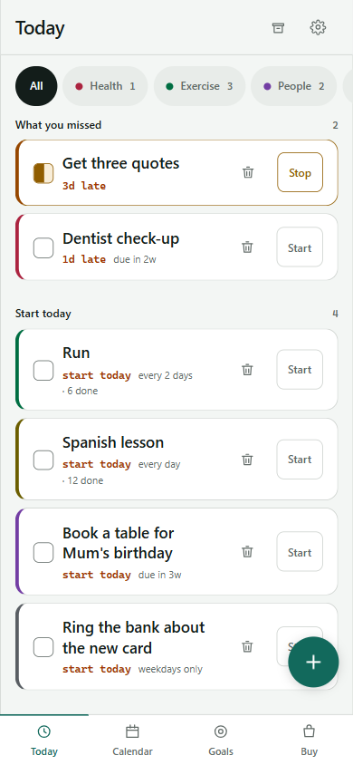
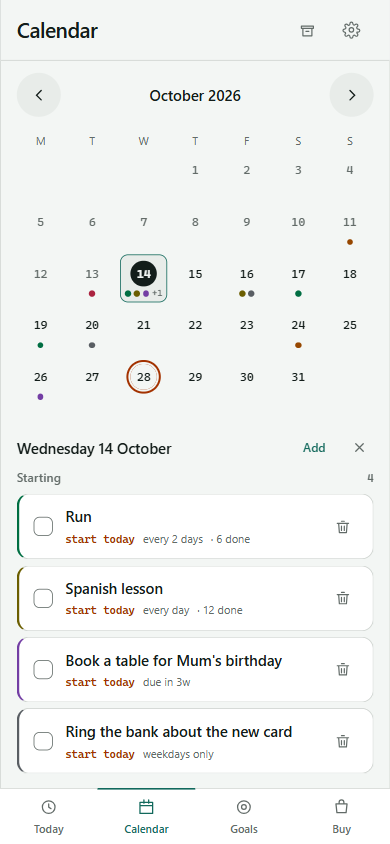
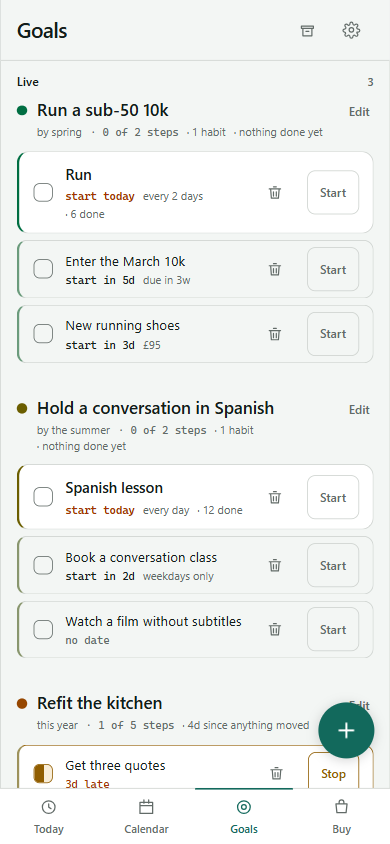
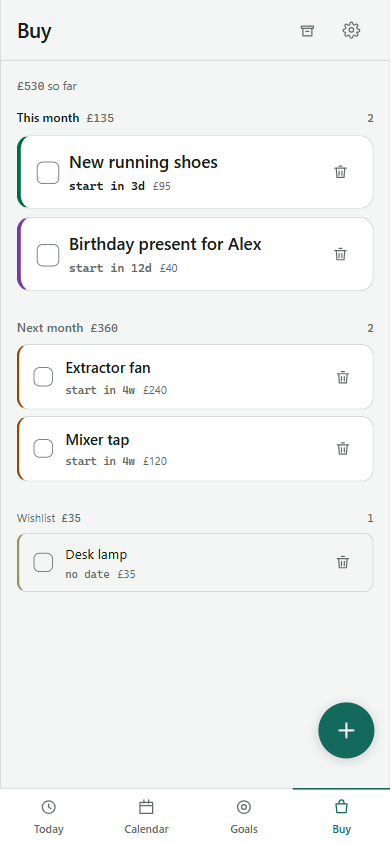

# Lifeboard

A phone-first tracker for tasks, goals and shopping that sorts by when you need to *start* something, not when it is due.

<table>
  <tr>
    <td></td>
    <td></td>
    <td></td>
    <td></td>
  </tr>
</table>

<sub>Screenshots are of the made-up data in [`scripts/demo-state.ts`](scripts/demo-state.ts).</sub>

## The idea

A flat to-do list fails in a predictable way. "Buy a desk lamp" sits at the same altitude as "renew the passport", every glance costs you a re-derivation of what matters, and you stop glancing.

So the field doing the real work is `act`, the last responsible moment to start. A table booked for a birthday three weeks out has an `act` of today even though its `due` is weeks away, and every card leads with "start today" or "start in 5d" and demotes the deadline to secondary text. Sorting, the Today lanes and the calendar all derive from it.

A few more fields cover what a plain due date can't say. `unblocks` hides an item until it can actually be done (a refund you can't claim for another two days only teaches you to ignore the list if it shows up today). `weekdaysOnly` marks the phone calls: on a Sunday those cards read "opens Monday" and drop out of the actionable set. `recurrence` makes completing an item schedule the next one, with an optional end. `buy` and `cost` put an item on the shopping tab and roll it into a budget.

## Screens

**Today** leads with what you missed, then what to start today, then a quieter list of what starts this week. Anything further out or undated folds away underneath. Overdue work also gets a pass of its own, one item at a time, to finish, re-date (today, tomorrow, next week) or drop.

**Calendar** is a month grid with category-coloured dots. Items land on their deadline where they have one, otherwise their start date, and genuinely undated things stay off it, because forcing dates onto things that don't have them is how calendars start lying.

**Goals** own steps rather than a separate checklist. A step is an ordinary item with a `goalId`, so a goal can hold a repeating habit alongside one-off checkpoints, and its progress and staleness are read off real completions.

**Buy** groups purchases into this month, next month and wishlist, with cost optional because most things arrive before you know the price.

## How it's put together

It is a local-first PWA (React 19, TypeScript, Vite, Tailwind v4). State lives in IndexedDB and the app works with no account and no connection. Everything beyond that is optional and switched on per environment by Terraform feature flags (`enable_auth`, `enable_capture`, `enable_push`), so a fresh account applies cleanly with all of them off.

**Sync** is one JSON document per user in S3, written straight from the browser with Cognito identity-pool credentials scoped to that user's prefix. There is no API and no database in the request path. Writes are conditional on the last ETag; a `412` means another device got there first, so the client re-reads and merges per item rather than letting the last whole-document write win. Sign-in is Google through the Cognito hosted UI, behind a pre-signup allowlist.

**Brain dump** turns dictated or typed text into draft items with one Claude Haiku call in a Lambda. Structured output pins the shape and the handler re-validates it, so a schema drift fails loudly rather than as a wrong date in the list. Spend is capped in DynamoDB per user and globally per month, checked before the model is called rather than reconciled afterwards, because the Anthropic bill is the one cost that scales with use and AWS Budgets can't see it.

**Notifications** are two scheduled digests a day (07:30 and 20:30, London time) sent with Web Push and suppressed when there is nothing to say. The dispatcher can read a per-user digest of counts and dates and nothing else; its IAM policy names `digest.json`, so it cannot open the document that holds your titles.

Everything else (pressure, blocking, windows, archiving) is deterministic and stays in code. Paying per token to compute a date difference would be absurd.

Deploys run from GitHub Actions through OIDC, with path-filtered jobs so a docs change doesn't redeploy the app. [`infrastructure/README.md`](infrastructure/README.md) covers each module, the apply order and the monthly cost.

## How it was built

Most of the code was written by Claude Code agents working in parallel git worktrees, a lot of it overnight, while I wrote the briefs, reviewed the hand-off logs and did every merge. [`docs/how-it-was-built.md`](docs/how-it-was-built.md) is the longer story, including the Terraform plan that would have destroyed the TLS certificate and the Cognito domain if it had been applied.

## Running it

```bash
npm install
npm run dev      # http://localhost:5173, local-only, no account needed
npm run gate     # lint, JS and Python tests, production build
```

The Python tests cover the Lambdas and need `pytest` plus each Lambda's `requirements.txt`. To try the app with data in it, write the output of `npx tsx scripts/demo-state.ts` to the `lifeboard.state` localStorage key in a fresh browser profile and reload.

The backend is optional. Copy `.env.example` to `.env` once Terraform has created the auth and sync resources; the infrastructure README has the steps.


## License

[MIT](LICENSE)
